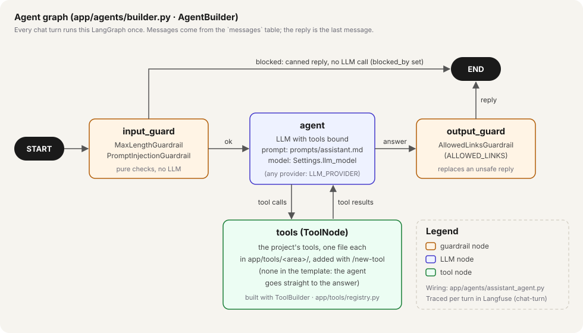

# Agents

The app runs one LangGraph agent, the **assistant**, composed by `AgentBuilder`. Each chat turn
runs the graph once: guard the input, let the LLM answer (calling tools as many times as it
needs), guard the output.



## How the assistant is built

`assistant_agent.py` is the whole definition:

```python
AgentBuilder(settings.app_name)
    .with_llm(llm)                                   # app/core/llm.py: OpenRouter / Anthropic / OpenAI
    .with_prompt_file("assistant.md")                # prompts/assistant.md
    .with_tools(tools)                               # app/tools/registry.py: build_assistant_tools
    .with_input_guardrails([MaxLengthGuardrail(...), PromptInjectionGuardrail()])
    .with_output_guardrails([AllowedLinksGuardrail(settings.allowed_links)])
    .build()                                         # -> compiled StateGraph
```

`AgentBuilder.build()` (`builder.py`) always produces the same graph shape:

| Node | Does | Next |
| --- | --- | --- |
| `input_guard` | runs the input guardrails on the user's last message | blocked: a canned reply, then **END** (no LLM call); ok: `agent` |
| `agent` | the LLM with the system prompt and the tools bound | tool calls: `tools`; an answer: `output_guard` |
| `tools` | LangGraph `ToolNode`: runs the requested tools, returns their results (only when the agent has tools) | back to `agent` |
| `output_guard` | runs the output guardrails on the reply | **END**; a blocked reply is replaced in place (same message id) |

State (`state.py`): LangGraph's `MessagesState` plus `blocked_by`, the reason a guardrail
intervened (recorded in Langfuse and in the evaluator's checks).

Where the pieces come from:

| Piece | Location | Notes |
| --- | --- | --- |
| System prompt | `prompts/assistant.md` | Markdown, never inline strings; the template's is a placeholder |
| LLM | `app/core/llm.py` (`build_chat_model`) | provider and model from `Settings` (`LLM_PROVIDER`, `LLM_MODEL`) |
| Tools | `app/tools/<area>/<tool>.py`, registered in `app/tools/registry.py` | each built with `ToolBuilder` from a recipe (`/new-tool`) |
| Guardrails | `app/guardrails/input.py`, `output.py` | pure checks, unit-tested |
| Wiring | `app/api/deps.py` (`get_chat_service`) | the only place concrete classes meet |
| Invocation | `app/services/chat_service.py` | loads history from `messages`, traces the turn, persists the reply |

## Modify the assistant

| Change | Where | Then |
| --- | --- | --- |
| How it answers (tone, rules, scope) | `prompts/assistant.md` | `make test`, then `make eval args="--mode answer"` |
| A new capability | a new tool: run `/new-tool` (one file in `app/tools/<area>/`, register in `registry.py`, unit test) | mention when to use it in `prompts/assistant.md`; add eval cases |
| A new safety rule | a guardrail class in `app/guardrails/` with `name` and `check(text)`, added to `assistant_agent.py` | unit test in `tests/test_guardrails.py` |
| The links it may write | `ALLOWED_LINKS` in `.env` and Vercel | a `guardrail` eval case |
| The model | `LLM_PROVIDER` / `LLM_MODEL` in `.env` and Vercel | `make eval` and compare the experiment in Langfuse |

Every behaviour change should be followed by an evaluation run: the evaluator runs this exact
agent (see [`app/evals/README.md`](../evals/README.md)).

## Create a new agent

Use `/new-agent <name> <its job>` in Claude Code, which follows these steps:

1. **Prompt first**: `prompts/<name>.md` (role, how to answer, scope in and out, style), modelled on
   `assistant.md`.
2. **Agent**: `<name>_agent.py` with `build_<name>_agent(llm, tools, settings)` using
   `AgentBuilder`; reuse the existing guardrails unless the agent needs different ones.
3. **Tools**: a `build_<name>_tools(deps)` function in `app/tools/registry.py`.
4. **Wiring**: only in `app/api/deps.py`; routes and services never build agents.
5. **Test** the graph with a fake LLM, no real calls:

   ```python
   llm = GenericFakeChatModel(messages=iter([AIMessage("hello")]))
   graph = AgentBuilder("test").with_llm(llm).with_prompt_file("assistant.md").build()
   state = graph.invoke({"messages": [HumanMessage("hi")]})
   ```

   (see `tests/test_builders.py`).
6. If several agents need routing between them, describe it in `docs/architecture/backend.md`.
7. `make check`.

`AgentBuilder` keeps the same guard → agent ⇄ tools → guard shape for every agent, so a new agent gets
input/output guardrails and Langfuse tracing without extra code.
